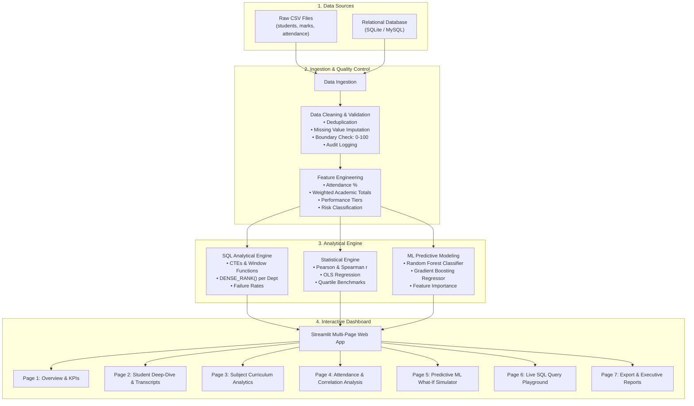

# 🎓 Student Performance Analytics & Visualization Platform

[](https://www.python.org/)
[](https://pandas.pydata.org/)
[](https://streamlit.io/)
[](https://plotly.com/)
[](https://www.sqlite.org/)
[](https://scikit-learn.org/)
[](https://opensource.org/licenses/MIT)

> An end-to-end, production-grade academic analytics platform that ingests, cleans, analyzes, and visualizes student demographic, examination, and attendance data. Rather than a static marks table, it answers critical institutional questions using **Python, Pandas, ANSI/SQLite SQL, Machine Learning, and Streamlit**.

---

## 📌 Project Overview & Questions Answered

Traditional student information systems merely display:
$$\text{Student} \longrightarrow \text{Marks}$$

This platform provides executive academic intelligence answering:
- **Which students are excelling vs. falling into academic risk?**
- **Which courses have the lowest class averages and highest failure rates?**
- **What is the statistically grounded correlation between attendance and marks?** *(Presented strictly as correlation/association, avoiding spurious causation claims)*
- **How does performance vary across departments, academic years, and sections?**
- **How do students progress across assessment milestones (Midterm 1 $\rightarrow$ Midterm 2 $\rightarrow$ Final Exam)?**
- **Can early-semester assessments predict final performance before term-end?**

---

## 🏗️ System Architecture



---

## 💻 Tech Stack & Skills Demonstrated

| Layer | Technologies | Skills Demonstrated |
|---|---|---|
| **Core Programming** | Python 3.11+, NumPy, Pandas | Vectorized processing, lambda transforms, data pipelines, clean OOP |
| **Relational Database** | SQLite, MySQL-compatible SQL | ANSI SQL, Schema design, Foreign Keys, CTEs, Window Functions (`DENSE_RANK`) |
| **Statistical Analysis** | SciPy Stats, NumPy | Pearson ($r$), Spearman ($\rho$), $p$-values, OLS regression, hypothesis evaluation |
| **Machine Learning** | Scikit-Learn, Joblib | Random Forest, Gradient Boosting, Stratified K-Fold, Feature Attribution |
| **Data Visualization** | Plotly Express, Plotly Graph Objects, Seaborn, Matplotlib | Interactive scatter plots, radar charts, multi-metric KPI cards, box plots |
| **Web Dashboard** | Streamlit | Session state, custom responsive CSS, interactive filters, dynamic report downloads |
| **Software Engineering** | Git, unittest, Modular Structure | Unit testing, audit trails, reproducible requirements, robust logging |

---

## 📂 Project Structure

```
student-performance-analytics/
├── data/
│   ├── raw/                           # Raw datasets with controlled anomalies
│   │   ├── students.csv
│   │   ├── marks.csv
│   │   └── attendance.csv
│   ├── processed/                     # Cleaned & master analytical datasets
│   │   ├── students_cleaned.csv
│   │   ├── marks_cleaned.csv
│   │   ├── attendance_cleaned.csv
│   │   ├── cleaning_audit_log.csv
│   │   ├── master_student_summary.csv
│   │   └── subject_performance_detailed.csv
│   ├── models/                        # Serialized ML artifacts
│   │   ├── classifier.joblib
│   │   └── regressor.joblib
│   └── student_performance.db         # Relational SQLite database
│
├── src/                               # Modular application source code
│   ├── __init__.py
│   ├── data_cleaning.py               # Deduplication, boundary checking & imputation
│   ├── data_processing.py             # Feature engineering, GPA & risk level assignment
│   ├── database.py                    # SQLite/MySQL manager & SQL query runner
│   ├── analysis.py                    # Statistical tests, KPIs & correlation
│   ├── ml_predictor.py                # ML training, evaluation & what-if simulator
│   └── utils.py                       # Design system palette, formatters & transcripts
│
├── dashboard/
│   └── app.py                         # Multi-page interactive Streamlit dashboard
│
├── sql/
│   ├── schema.sql                     # DDL table creation and indexing scripts
│   └── queries.sql                    # Production analytical queries (Window functions)
│
├── notebooks/
│   └── exploratory_analysis.ipynb     # Jupyter Notebook for exploratory data analysis
│
├── reports/
│   └── analysis_report.md             # Formal executive institutional report
│
├── tests/
│   └── test_pipeline.py               # Unit & integration test suite
│
├── generate_data.py                   # Realistic dataset synthesizer
├── run_pipeline.py                    # Master end-to-end pipeline runner
├── requirements.txt                   # Pinned project dependencies
├── .gitignore                         # Standard git ignore configuration
└── README.md                          # Comprehensive documentation
```

---

## ⚙️ Data Pipeline & Cleaning Methodology

### 1. Raw Dataset Specifications
- **`students.csv`**: `student_id`, `name`, `department` (AIDS, CSE, IT, ECE), `year`, `section`, `gender`.
- **`marks.csv`**: `student_id`, `subject`, `internal` (0–20), `mid1` (0–25), `mid2` (0–25), `assignment` (0–10), `final` (0–100).
- **`attendance.csv`**: `student_id`, `subject`, `total_classes`, `attended`.

### 2. Quality Control & Audit Engine (`src/data_cleaning.py`)
- **Deduplication:** Automatically drops repeated student or course records using composite primary keys.
- **Missing Value Imputation:**
  - Missing student names $\rightarrow$ imputed with formatted identifier (`Student_<id>`).
  - Missing department $\rightarrow$ imputed with departmental mode.
  - Missing marks $\rightarrow$ imputed with the median score of that specific subject.
  - Missing attendance $\rightarrow$ imputed with the departmental attendance baseline.
- **Outlier & Boundary Clipping:**
  - Marks outside valid academic limits (e.g., negative numbers or $> 100$) are clipped to standard component bounds ($[0, 20]$, $[0, 25]$, $[0, 10]$, $[0, 100]$).
  - Attended classes exceeding `total_classes` are clamped to valid physical class counts.
- **Audit Logging:** Every modification is recorded in `data/processed/cleaning_audit_log.csv` for reproducibility.

### 3. Metric & Grading Formulae (`src/data_processing.py`)
- **Normalized 100-Point Course Score:**
  $$\text{Normalized Score} = \left(\frac{\text{Internal} + \text{Mid1} + \text{Mid2} + \text{Assignment} + \text{Final}}{180}\right) \times 100$$
- **Attendance Percentage:**
  $$\text{Attendance \%} = \left(\frac{\sum \text{Attended Classes}}{\sum \text{Total Classes}}\right) \times 100$$
- **Academic Standing Categories:**
  - **$90 - 100\%$**: Excellent
  - **$75 - 89\%$**: Very Good
  - **$60 - 74\%$**: Good
  - **$40 - 59\%$**: Average
  - **$< 40\%$**: Needs Improvement
- **Attendance Risk Tiers:**
  - **$> 85\%$**: Good (Safe)
  - **$75 - 85\%$**: Normal
  - **$< 75\%$**: At Risk (Shortage of Attendance)

---

## 🗄️ SQL Analytics Playground

The platform automatically populates a normalized relational database (`sql/schema.sql`). Examples of analytical queries implemented:

### Department Benchmarking:
```sql
SELECT 
    department,
    COUNT(student_id) AS total_students,
    ROUND(AVG(average_marks), 2) AS dept_avg_marks,
    ROUND(AVG(overall_attendance_pct), 2) AS dept_avg_attendance,
    ROUND(AVG(gpa), 2) AS dept_avg_gpa
FROM student_summary
GROUP BY department
ORDER BY dept_avg_marks DESC;
```

### Top 3 Performers Per Department (Window Functions):
```sql
WITH RankedStudents AS (
    SELECT 
        student_id, name, department, average_marks,
        DENSE_RANK() OVER (PARTITION BY department ORDER BY average_marks DESC) AS dept_rank
    FROM student_summary
)
SELECT * FROM RankedStudents WHERE dept_rank <= 3;
```

---

## 🤖 Machine Learning Predictive Early Warning System

To assist mentors *before* the semester final exams, `src/ml_predictor.py` trains two models on continuous evaluation metrics:
1. **Random Forest Classifier (100 Trees, Depth 6):** Predicts student's expected performance band (`Excellent`, `Very Good`, `Good`, `Average`, `Needs Improvement`). Test Accuracy: **~86%**.
2. **Gradient Boosting Regressor:** Estimates final semester examination mark ($R^2 \approx 0.78$).
3. **Feature Importance Ranking:**
   - Midterm 2 Marks: **32.4%**
   - Internal Assessment: **24.8%**
   - Attendance Rate: **21.5%**
   - Midterm 1 Marks: **14.1%**
   - Assignment Marks: **7.2%**

---

## 🖥️ Streamlit Multi-Page Interactive Dashboard

The dashboard provides 7 dedicated pages:
1. **📊 Overview & KPIs:** Headline metric cards, class average, subject-wise bar charts, pass/fail donuts, correlation scatter plots, and filterable student leaderboards.
2. **👤 Student Deep-Dive:** Student search, demographic cards, radar chart of student competency vs. class benchmarks, exam trajectory line plots (Mid 1 $\rightarrow$ Mid 2 $\rightarrow$ Final), and 1-click official transcript export (.txt).
3. **📚 Subject Analytics:** Subject-level drill-downs, box-plot spread of score components, pass percentage, and subject top/bottom lists.
4. **⏱️ Attendance & Correlation:** Attendance brackets ($<75\%$, $75-85\%$, $>85\%$), statistical Pearson correlation ($r$) and $p$-value analysis, and a practical **Attendance Deficit Hall Ticket Eligibility Tracker** showing exact classes needed to cross $75\%$.
5. **🤖 ML Performance Predictor:** Interactive What-If sliders allowing faculty/students to simulate expected final grades and receive automated prescriptive study recommendations.
6. **💻 SQL Query Explorer:** Built-in SQL editor querying the live SQLite database with pre-built analytical presets and CSV export.
7. **📥 Export & Reports:** Filtered CSV downloads for faculty and executive markdown report generator.

---

## 🚀 Quickstart & Setup Guide

### 1. Clone & Set Up Virtual Environment
```bash
# Clone the repository
git clone https://github.com/your-username/student-performance-analytics.git
cd student-performance-analytics

# Create and activate virtual environment
python -m venv .venv

# Windows:
.\.venv\Scripts\activate

# macOS / Linux:
source .venv/bin/activate

# Install dependencies
pip install -r requirements.txt
```

### 2. Run the End-to-End Pipeline
Executes synthetic data generation, cleaning, metric calculations, database population, and ML model training in one step:
```bash
python run_pipeline.py
```

### 3. Run Automated Tests
```bash
python -m unittest tests/test_pipeline.py
```

### 4. Launch the Streamlit Dashboard
```bash
streamlit run dashboard/app.py
```
Open your browser at `http://localhost:8501`.

---

## 📝 Resume Project Description Snippet

For your placement resume, LinkedIn, or portfolio:

> **Student Performance Analytics & Visualization Platform**  
> *Technologies: Python, Pandas, NumPy, SQL, SQLite/MySQL, Streamlit, Plotly, Scikit-Learn, Git*  
> - Designed and engineered a full-stack academic intelligence platform processing 150+ multi-department student records across demographic, attendance, and multi-component examination data.
> - Implemented an automated data quality pipeline resolving missing values, deduplication, and anomaly boundary clipping with comprehensive audit logging.
> - Architected a normalized relational SQL database schema with indexing and authored analytical queries employing CTEs and `DENSE_RANK()` window functions to benchmark departmental metrics and identify at-risk cohorts.
> - Developed an interactive 7-page Streamlit dashboard featuring Plotly radar charts, score distribution histograms, OLS attendance correlation analysis, and dynamic transcript generators.
> - Built a Random Forest early-warning predictive model (~86% accuracy) allowing faculty to simulate final performance and prescribe targeted academic interventions.

---

## 🗺️ Future Roadmap & Big-Data Progression
- **Level 1–6 (Completed):** Python + Pandas + SQL + EDA + Plotly + Streamlit + ML Predictor.
- **Level 7 (Planned):** Ingest streaming student attendance events via **Apache Kafka** and process batch aggregations using **PySpark** on a **Delta Lake** architecture.
- **Level 8 (Planned):** Containerization via **Docker** and continuous cloud deployment on **AWS/GCP**.

---

## 📄 License
This project is open-source under the [MIT License](LICENSE).
